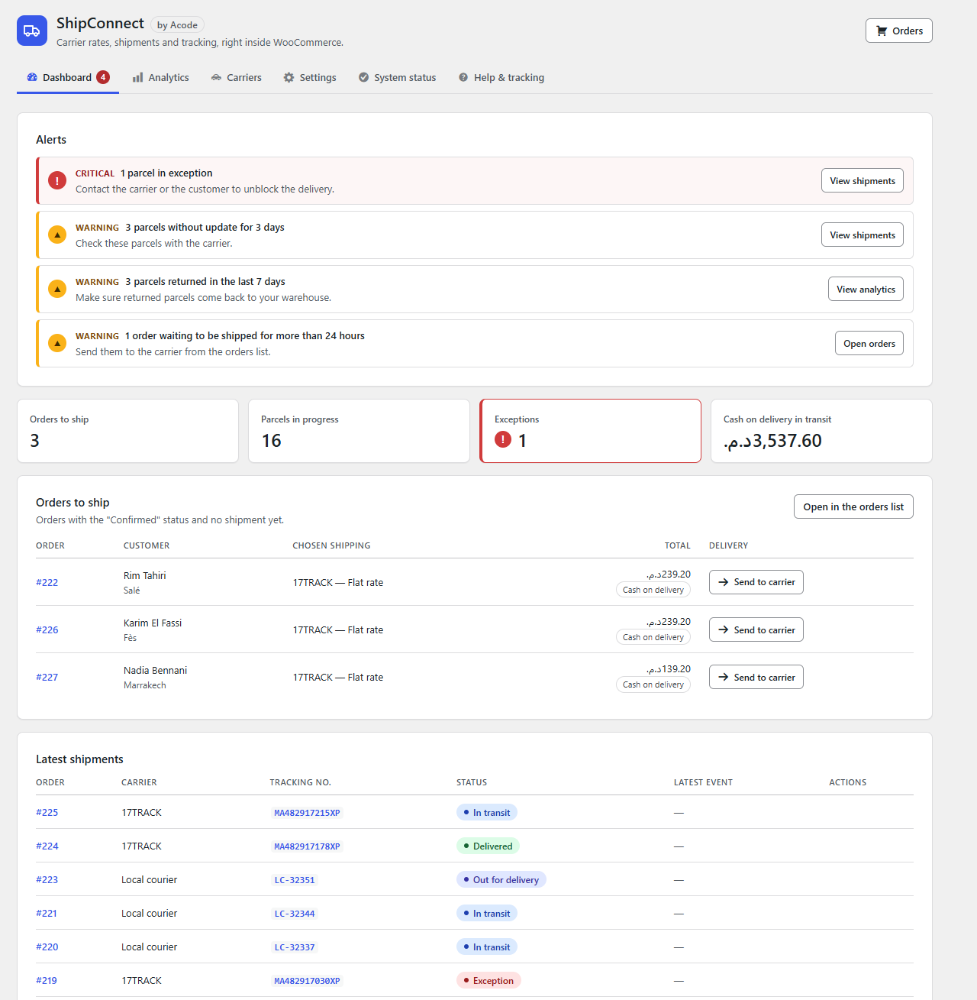

# ShipConnect for WooCommerce

**by [Acode](https://acode.tech/)** - free, GPL-2.0-or-later, version 0.2.0 (early release)

> Confirm the order. The parcel follows.

Connect your WooCommerce shop to your delivery companies from one screen: live rates at checkout, shipments sent to the carrier in one click or automatically once an order is confirmed, automatic tracking, a dashboard and alerts.

Project page: https://acode.tech/shipconnect/ ([Français](https://acode.tech/shipconnect/fr/) - [العربية](https://acode.tech/shipconnect/ar/)) - Privacy: https://acode.tech/privacy/ - Support: contact@acode.tech

## Features

- **Live rates at checkout** from your connected carriers, with markup, handling fee, free-shipping threshold and a fallback rate.
- **Confirm, then ship**: a "Confirmed" order status, cash-on-delivery orders held until you confirm them, a "Send to carrier" button in the orders list, a bulk action, or fully automatic sending.
- **Price check before buying** (API carriers): pick the service from the order's rates before the shipment is created.
- **Correct or cancel** a shipment (also with the carrier when it supports it), then create a new one.
- **Automatic tracking** every 30 minutes and through webhooks: order notes, order status, a "Track my parcel" box for the customer and tracking in emails.
- **Dashboard, analytics and alerts**: delivery rate, average delivery time, returns, cash on delivery in transit, charts, alerts.
- **Carriers without an API**: manual tracking, tracking link, optional flat rate.
- **Worldwide catalogue** of 211 delivery companies with country, region and API filters (indicative, from desk research).
- English and French interface (follows the WordPress language).

## Carriers

| Connection | Type | Cash on delivery | Label | Webhook |
|---|---|---|---|---|
| Sendit (Morocco) | national | yes | yes | yes |
| Quick Livraison (Morocco) | national | yes | PDF | yes |
| Mylerz (Morocco) | national | yes | AWB | no |
| Colivry (Morocco) | national | yes | none via API | yes |
| Atlas Livraison (Morocco) | national | yes | none via API | yes |
| Shippo | aggregator | - | yes | yes |
| EasyPost | aggregator | - | yes | yes |
| DHL Express (MyDHL API) | international | - | yes | no (regular checks) |
| Aramex | international | - | yes | no (tracking not connected yet) |

Any other carrier: add it as a carrier without API.

> **Early release - test first.** The API connections are built from each carrier's official documentation and checked against simulated responses. They have **not yet been validated with real carrier accounts**. Test each connection with the carrier's test/sandbox keys on a test order before production.

## Requirements

WordPress 6.4+, WooCommerce 8.0+ (HPOS compatible), PHP 7.4+ with sodium (recommended) or OpenSSL, outbound HTTPS to the carriers' APIs.

## Install

1. Download `shipconnect-for-woocommerce.zip` from the [latest release](../../releases/latest).
2. WordPress admin > Plugins > Add New > Upload Plugin > install and activate (WooCommerce must be active).
3. Open WooCommerce > ShipConnect Shipping and follow the "Get started" checklist: connect a carrier, add the ShipConnect method to a shipping zone, complete the sender address.

Recommended: define `SHIPC_ENCRYPTION_KEY` in `wp-config.php`. On Nginx, deny direct access to `wp-content/uploads/shipconnect-private/`.

## Known limits (0.2.0)

One parcel per order. Aramex: live rates and automatic tracking not connected yet. Colivry and Atlas Livraison: no label via their API. Customs declarations for DHL Express only. Block-based WooCommerce checkout not verified.

## Privacy

ShipConnect sends nothing to Acode. It contacts a carrier only after you connect it with your own account; recipient name, address, phone, email and parcel details are then sent to that carrier to quote, create and track shipments. API keys are encrypted (libsodium). Details: [External services](readme.txt) and https://acode.tech/privacy/.

## Contributing / support

Issues and pull requests welcome. Questions: contact@acode.tech. Security reports: contact@acode.tech (please do not open a public issue).

## Licence

GPL-2.0-or-later. See `LICENSE`.

ShipConnect is an independent plugin by Acode. It is not affiliated with or endorsed by WooCommerce, Automattic or the carriers it connects to; their names are trademarks of their owners.
